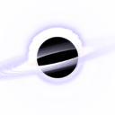

<p align="center"></p>

# Beyond the Glass

[](https://github.com/Evirtual/beyond/actions/workflows/pages.yml)

A window you look through, not a page you look at. Live at
[beyond.edgarasneverdauskas.com](https://beyond.edgarasneverdauskas.com).

Home is a floating world behind the glass: islands, crystals and drifting pieces that
change while you watch, in the light of your own time of day and tonight's real moon. Lean
(move the mouse or tilt by touch) and the window parallax shows what lies behind the edges.

Scroll, or let it drift, and a black hole pulls you on: it grows from a dot in the distance
until it swallows the view, and you come out the other side into the world waiting inside it.
For now that world is home again; what lies beyond the black hole is being reimagined.

## Controls

- **Mouse / touch:** lean into the window.
- **Scroll / swipe:** travel; the black holes pull a little on their own.
- **drift** (bottom right) or **space:** fly on by itself. While drifting, the slider or the
  ↑ / ↓ keys set the pace.
- **Tap:** things react.

## Addresses

- `?v=1a2b3c4d`: a particular journey (any 8 hex characters). Without it, every visit is new.
- `?at=3`: start a few black holes further in (any step number).

## Running it

```bash
npm install
npm run dev
```

```bash
npm run build
```

Built with React, Vite, three.js and React Three Fiber. The frame rate is paced to what the
moment needs (fewer frames when you are still) and the resolution steps down if frames run
slow, so it stays gentle on laptops.

## Install on your phone

Open the live site in Safari on iPhone and choose **Share → Add to Home Screen**,
or choose **Install app / Add to Home screen** in Chrome on Android.
Beyond requests fullscreen when installed and works offline after its first complete online load.
The scene extends behind display cutouts; corner controls respect the device's safe areas.
Updates become active once all open app windows and browser tabs are closed and reopened.

The transparent browser favicon is kept separate from the dark, padded phone icons.
Run `npx playwright install chromium` once, then `npm run icons` to render PNGs
directly from the black-hole shader in `src/scene/Glass.tsx`. Alternatively set
`ICON_BROWSER_CHANNEL=msedge` to use an installed Edge browser.
The generator freezes the animation and uses pale lilac lighting on black;
small transparent icons use a closer crop for readability.
PWA caching is enabled in production builds; use `npm run build` and `npm run preview`
to test it locally.

## Licence

[AGPL-3.0](LICENSE).
